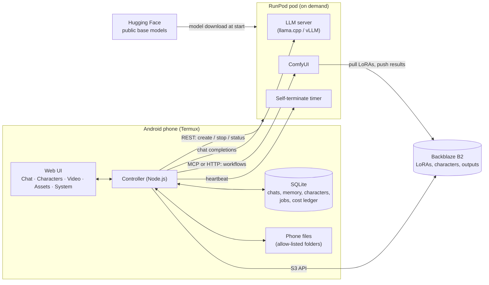

# Personal AI Creative Agent: research findings, architecture and roadmap

Status: first-pass research, 11 November 2026. Prices marked **verified** come from the
vendor's pricing page as reported by search on that date; check the live console before
spending. Everything marked **estimate** is unmeasured and must be benchmarked.

## 1. Headline recommendations

1. **The phone is the backend.** The brief describes "phone → Termux companion → secure
   backend → agent". There is no need for a separate backend: the controller already in
   `controller/` runs in Termux, holds the keys, stores the database and reaches phone
   files directly. One fewer machine to pay for and secure.
2. **Do not keep public models in Backblaze.** B2 egress is free only up to 3× your stored
   volume per month, then $0.01/GB. Re-downloading a 20 GB model on every pod start would
   blow through that. Pull public base models from Hugging Face (free) and keep only what
   is yours in B2: LoRAs, characters, references, outputs.
3. **No network volume at the start.** A 100 GB RunPod volume costs $7/month whether or not
   you use it, which is 14% of the whole budget every month. Downloading ~20 GB at pod
   start costs roughly 3–5 minutes of GPU time (about 2–3 cents, estimate). Revisit only
   if startup time becomes the main annoyance.
4. **The brain is the expensive part, not the images.** A language model needs the GPU for
   as long as you are chatting. At $0.22–0.34/hour, $50 buys roughly 150–225 hours of
   total GPU time for everything. Image generation, by contrast, costs a fraction of a
   cent per image. See section 4 for the options.
5. **Spending limits live in code, not in the model.** The agent may *request* a pod; the
   controller checks the estimate against the remaining budget and asks you. A model that
   misjudges or is talked into something cannot overspend.
6. **The pod must shut itself down.** Android can kill Termux at any time. If the phone is
   the only thing that stops pods, a dead phone means a pod billing all night. Every pod
   gets a self-terminate timer that the controller must keep renewing.
7. **Few built-in tools, MCP for extensions.** A 20 GB local model gets unreliable when
   shown dozens of tool definitions. RunPod and B2 become a handful of built-in tools
   calling their REST/S3 APIs directly. MCP is the plug-in mechanism for ComfyUI and
   anything added later.
8. **Your existing LoRAs choose the image model, not the other way round.** Krea 2 cannot
   load SDXL, Pony, Illustrious or Flux LoRAs. Until we know what your LoRAs were trained
   on, the base model is undecided.
9. **Postpone Blender, Houdini and UE5.** They are absent from this brief, and UE5 alone
   could eat the budget in setup time.
10. **Video replacement is a benchmark first, a feature second.** Nobody can price it
    without running a 5-second clip on real hardware. Budget $2–3 for that experiment
    before designing the Video Studio around it.

## 2. What already exists and how it fits

`controller/` (milestone 1, built and tested) is the foundation and needs no rework:

| Brief requirement | Current state |
| --- | --- |
| Chat, history, streaming | Done |
| Model switching without rebuild | Done: any OpenAI-compatible endpoint, set in Settings |
| Keys kept off the interface | Done: key is stored server-side and never returned |
| Orchestration independent of GPU | Done: runs on the phone with the GPU off |
| Five-section navigation, violet/blue identity | Not yet: current UI is chat only, neutral dark |
| Tools, approvals, activity view | Not yet |

## 3. Architecture

**Controller modules** (each independently testable against a mock):

- `agent`: the tool-calling loop. Validates every tool call against its schema, retries
  malformed calls, caps iterations, records every step for the activity view.
- `tools`: registry. Built-ins (RunPod, B2, phone files, memory) plus MCP clients.
  Each tool declares a risk level: read-only runs freely, anything that costs money,
  deletes or overwrites raises an approval card in the chat.
- `budget`: a ledger. Every pod start records rate and start time; cost accrues per
  minute; a hard cap refuses new jobs when the estimate exceeds what is left.
- `runpod`: lifecycle. Pick cheapest suitable GPU, start, wait for health, renew the
  self-terminate timer, stop when idle or when a job completes.
- `storage`: B2 through its S3-compatible API with a key restricted to one bucket.
- `files`: phone access limited to folders you allow-list (Termux shared storage:
  Downloads, DCIM, Pictures, Movies; other apps' private data is not reachable).
- `memory`: structured tables for projects, characters, assets and tasks, plus SQLite
  full-text search. No vector database: there is no embedding model on the phone, and
  keyword search over structured records covers "continue working on character X".

**GPU lifecycle:** request → cost estimate → budget check → your approval → start pod →
download models → run → upload results to B2 → stop pod → write actual cost to ledger.

**Security model:** controller listens on localhost only; keys in the database with
file mode 600 (encryption at rest is a later hardening step); cross-origin requests
refused; restricted B2 key; per-integration on/off switch; full operation log.
For video, real-person footage requires an explicit consent confirmation, and
sexualised content involving minors or non-consenting real people is refused, as the
brief specifies.

## 4. The brain: options and recommendation

| Option | Cost | Trade-off |
| --- | --- | --- |
| A. Open-weight model on the pod, started on demand | $0.22–0.34/h while chatting; 3–5 min cold start (estimate) | Private, no content filter beyond the model's own, but every conversation spends budget |
| B. Free hosted API tier for planning | $0 | Rate limits, provider content policies, your prompts leave your infrastructure |
| C. Small model on the phone | $0 | Too weak for reliable multi-step tool use |

**Recommendation:** A as the default, with the endpoint staying swappable so B or C can
be added for cheap everyday chat. The controller already supports this.

**Model candidates for a 24 GB card** (from secondary sources; must be tested on your
actual tool set before committing):

- **Qwen3.6-35B-A3B at Q4** (~20 GB, Apache 2.0): reported strongest all-round for
  agent work. Leaves no room for an image model on the same 24 GB card.
- **Gemma 4 26B/27B at Q4** (~15–16 GB): strong tool calling, leaves some headroom.
- **Mistral Small 3.2 24B at Q4** (~14 GB): solid function calling, smallest.

Dolphin and Hermes fine-tunes are built on older bases and generally call tools less
reliably than current base models; I would test a current base model first and only fall
back to a fine-tune if refusals actually get in the way of orchestration.

**The VRAM conflict:** a 20 GB brain and an image model (SDXL ~8–10 GB; Krea 2 ~12 GB
plus an ~8 GB text encoder) do not fit together in 24 GB. Either use a smaller brain,
unload the brain while ComfyUI runs, or rent a 48 GB card. Start with unloading: it is
free and the agent is waiting for the job anyway.

## 5. Image and video engines

- **LoRA compatibility:** SDXL, Pony and Illustrious share an architecture but LoRAs
  trained on one often look wrong on another; Flux and Krea 2 are entirely separate.
  The controller will read each LoRA's embedded metadata (a few kilobytes at the start
  of the file, fetched without downloading the whole thing) and refuse mismatched pairs.
- **Krea 2:** open weights released June 2026 (Raw and 8-step Turbo, 12.9B parameters),
  native ComfyUI support, its own LoRA ecosystem. Licence is a "community licence" whose
  exact terms differ between sources; read it on Hugging Face before relying on it.
  Useful for new work, not for your existing LoRAs.
- **Character consistency:** character LoRA plus a fixed seed/prompt template per view,
  with IP-Adapter or face-reference conditioning and ControlNet pose for turnarounds.
  Exact workflow depends on the base family.
- **ComfyUI control:** Comfy publishes an official local MCP server (`comfy-mcp`).
  ComfyUI also has a plain HTTP API. Evaluate the MCP server first; fall back to HTTP.
- **Video character replacement:** Wan 2.2 Animate is the current open candidate.
  Reported comfortable at 24 GB with quantised (GGUF) weights, working floor 16 GB at
  reduced resolution. No trustworthy speed figure exists; benchmark required.

## 6. Budget

**Verified prices**

| Item | Price |
| --- | --- |
| RunPod RTX 3090, Community Cloud | from $0.22/h |
| RunPod RTX A5000, Community Cloud | $0.22/h |
| RunPod RTX 4090, Community / Secure | $0.34/h / $0.69/h |
| RunPod network volume | $0.07/GB/month |
| B2 storage | $6.95/TB/month, first 10 GB free |
| B2 download | free up to 3× stored, then $0.01/GB |

Stopped pods still bill for their disk; pods must be terminated, not just stopped.

**Estimates (unmeasured)**

| Activity | Estimated cost |
| --- | --- |
| Pod cold start (pull ~20 GB, load) | 2–3 cents |
| One hour of chat with the brain | 22–34 cents |
| One SDXL image | well under 1 cent |
| A 12-view character sheet including startup | 5–10 cents |
| 5-second video replacement clip | unknown; allow $2–3 to find out |
| B2 for 50 GB of LoRAs and outputs | about 30 cents/month |

**Suggested split of the $50:** $10 development and testing, $3 video benchmark, $2
storage for six months, $35 for actual use. That is roughly 100–150 hours of mixed use.
It is not enough for an always-available assistant; it is enough for deliberate sessions.

## 7. Risks and weak points

- **Tool-call reliability of a quantised local model** is the single biggest technical
  risk. Mitigation: few tools, strict validation, retries, and a test suite of real tasks
  run against each candidate model.
- **Android killing Termux** mid-job. Mitigation: wake lock, battery-optimisation
  exemption, the pod's self-terminate timer, and jobs that resume from the ledger.
- **GPU availability:** Community Cloud cards come and go. The controller needs a
  fallback list of acceptable GPUs.
- **Video cost and quality** are unknown until benchmarked.
- **Scope:** the brief describes four products (assistant, character studio, video
  studio, asset manager). Each stage below must be usable on its own.

## 8. Roadmap

Reordered from the brief: infrastructure and budget control come before any tool that
can spend money, and memory moves earlier because Characters depend on it.

| # | Stage | Needs from you |
| --- | --- | --- |
| 1 | Chat foundation | **Done** |
| 2 | RunPod lifecycle, cost ledger, budget cap, self-terminate timer, System page | RunPod API key |
| 3 | Brain on the pod; agent loop, tool registry, approvals, activity view; model bake-off | Choice in section 4 |
| 4 | B2 storage and phone files; Assets page | Restricted B2 key |
| 5 | Memory and projects (structured tables + search) | — |
| 6 | ComfyUI on the pod, LoRA metadata check, single-image generation | Which LoRAs to start with |
| 7 | Character Studio: sheets, per-view regenerate, library | — |
| 8 | Video benchmark on a 5-second clip, then go/no-go | A test clip |
| 9 | Video Studio (replacement and style transfer) if the benchmark is affordable | — |
| 10 | Five-section navigation and visual identity pass, hardening, key encryption | — |

MCP client support lands in stage 3 and is first used for ComfyUI in stage 6.

## 9. Not yet researched

Left open deliberately rather than guessed: exact Krea 2 licence terms; Wan 2.2 Animate
speed; whether RunPod network volumes are available on Community Cloud; current
RunPod serverless rates (sources conflict); maintenance state of `comfy-mcp`; a
side-by-side tool-calling test of the three brain candidates.

## Sources

- RunPod pricing: https://www.runpod.io/pricing , https://www.runpod.io/gpu-instance/pricing
- RunPod MCP: https://github.com/runpod/runpod-mcp , https://docs.runpod.io/get-started/mcp-servers
- B2 pricing: https://upstash.com/blog/backblaze-b2-pricing-explained-2026 , https://egresscost.com/backblaze-b2
- Krea 2: https://github.com/krea-ai/krea-2 , https://docs.comfy.org/tutorials/image/krea/krea-2
- Wan 2.2 Animate: https://wan27.org/blog/wan-2-2-requirements-guide , https://aivideosensei.com/guides/wan-2-2-animate-guide
- LLM candidates: https://vdf.ai/blog/best-local-llm-by-vram/ , https://www.promptquorum.com/power-local-llm/best-local-models-tool-calling-2026
- ComfyUI MCP: https://comfyui-wiki.com/en/news/2026-08-11-comfy-mcp-local-server
- CodeOut: https://github.com/C9RE/codeout
