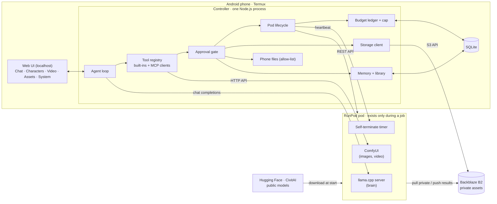
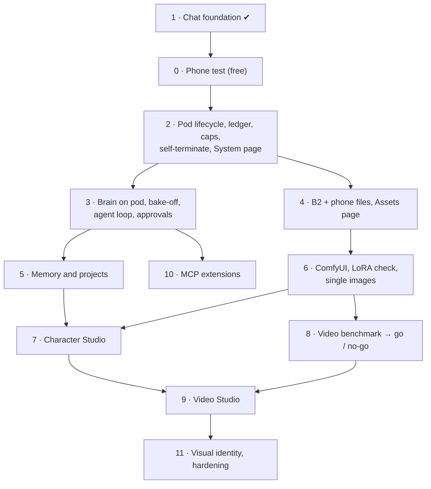

# Personal AI Creative Agent: research, architecture and roadmap

Version 2, 11 November 2026. Research and architecture only; no implementation beyond
the chat foundation that already exists. Awaiting approval before any further build.

**How to read the evidence labels**

- **[V]** verified against the vendor's own documentation or pricing page (via search on
  the date above; re-check the live console before spending).
- **[S]** reported by secondary sources (blogs, model mirrors); plausible, not confirmed.
- **[E]** my estimate; unmeasured.
- **[?]** open; could not be established and must be tested or read first-hand.

---

## 1. Recommendation in brief

Build a single small controller that runs on the phone, owns the keys, the database and
the budget, and rents a GPU pod only for the minutes a job needs it. Use ComfyUI on the
pod as the one engine for images and video, llama.cpp on the pod as the brain, and
Backblaze only for files that have no free public source. Reuse engines, not apps: no
existing assistant application fits a phone-hosted, budget-capped design, but the
engines underneath (ComfyUI, llama.cpp, Wan, the MCP SDK) are mature and should not be
rebuilt.

What I would change from the brief:

| Brief says | I recommend | Why |
| --- | --- | --- |
| Phone companion → separate backend → agent | The phone controller *is* the backend | One fewer machine to pay for, secure and keep alive |
| Store models, LoRAs and assets in B2 | Store only what has no public source; pull the rest from Hugging Face or CivitAI onto the pod | B2 downloads are free only up to 3× stored volume per month [V]; public sources are free every time |
| RunPod MCP as the infrastructure interface | RunPod REST API called by controller code; MCP optional for read-only queries | Starting and stopping paid hardware must be deterministic code behind a budget check, not a model's tool choice |
| ComfyUI via an MCP integration | ComfyUI's own HTTP API | The official `comfy-mcp` is self-described as an early proof-of-concept and is AGPL-or-commercial [V]; the HTTP API is stable and tiny |
| MCP as the core of everything | MCP as the extension socket; five to ten built-in tools as the core | Quantised local models get unreliable as the tool list grows |
| Krea 2 as a main image engine | Optional engine, pending a licence read | Gated weights; licence requires deployers to implement content filtering and follow an Acceptable Use Policy [V]. Cannot load your existing LoRAs |
| Dolphin / Hermes as brain candidates | Current base models first (Qwen 3.6, Gemma 4) | Both Apache 2.0, both newer and stronger at tool calling [S]; fall back to a fine-tune only if refusals actually block orchestration |
| Persistent storage on RunPod | None | Network volumes are Secure Cloud only [V], where GPUs cost about double; a stopped pod's disk bills at $0.20/GB/month [V] |
| Semantic search memory | Structured tables plus keyword search | No embedding model on the phone; the relationships in the brief (character → LoRA → settings) are relational, not fuzzy |
| Twelve build stages ending in security | Budget control and self-shutdown second, before anything can spend money | See roadmap |

---

## 2. Reuse assessment

### Applications considered as a base

| Project | Licence | Verdict | Reason |
| --- | --- | --- | --- |
| Existing `controller/` in this repo | MIT | **Keep as the base** | Already runs dependency-free, model-agnostic, keys server-side, tested |
| CodeOut | MIT [V] | Ideas only | Daemon depends on a native terminal library with no Android build; chat path is wrapped in a pairing protocol a localhost app does not need |
| Open WebUI, LibreChat, LobeChat, AnythingLLM | LibreChat MIT [S]; others [?] | Reject as base | Server-class stacks (Python or Node plus an external database); no evidence any runs under Termux [?]; none manages GPU lifecycle or a spend cap, which is the hard part here |
| OpenClaw | MIT [S] | **Reject** | Closest in spirit (personal agent, reported to run on Termux) but a poor security record: a one-click remote-code-execution CVE and hundreds of advisories in 2026 [S]. Not something to hand cloud keys and a wallet |
| SillyTavern | [?] | Not a fit | Role-play front end; useful only as evidence that a Node server on Termux is workable |

### Engines and libraries to adopt

| Component | Licence | Role | Notes |
| --- | --- | --- | --- |
| llama.cpp server | MIT | Serves the brain on the pod | OpenAI-compatible, GGUF quantised models, tool calling via `--jinja` [S]. vLLM is the alternative but wants the whole 24 GB card |
| ComfyUI | GPL-3 | Image and video engine on the pod | Used as a service over HTTP, so its licence does not bind the controller. RunPod publishes an official ComfyUI template [V] |
| Wan 2.2 Animate | Apache 2.0 [S] | Video character replacement | Has a dedicated replacement mode; quantised builds exist for 24 GB [S]. A "Wan-Animate 2" (Aug 2026) is reported [S][?] |
| MCP TypeScript SDK | MIT | MCP client in the controller | v1.30 is the stable line; v2 is beta [S]. Pure JavaScript, so it installs on Termux. This would be the controller's first npm dependency |
| runpodctl | — | Pod self-termination | Documented form: `runpodctl pod delete $RUNPOD_POD_ID` [V]; RunPod has no built-in auto-shutdown [V] |

### MCP servers assessed

| Server | Status | Decision |
| --- | --- | --- |
| RunPod official (`runpod/runpod-mcp`, hosted and npm) | Official, maintained [V] | Do not use for lifecycle; consider later for read-only inspection |
| Backblaze B2 | No official server found [?] | Use the S3-compatible API directly with a bucket- and prefix-restricted key [V] |
| `Comfy-Org/comfy-mcp` (official) | v0.10, "early proof-of-concept", AGPL/commercial [V] | Not now |
| `artokun/comfyui-mcp` (community) | Active as of Sept 2026, ships a RunPod image [S] | Re-evaluate at the ComfyUI stage |
| Blender MCP and similar | — | Out of scope until the core works |

---

## 3. Models: compatibility and licensing

### Brain candidates (24 GB card, 4-bit quantised)

| Model | Size | Licence | Notes |
| --- | --- | --- | --- |
| Qwen3.6-35B-A3B | ~20 GB [S] | Apache 2.0 [S] | Reported strongest for agent work; fills the card |
| Gemma 4 26B (A4B) / 31B | ~15–16 GB [S] | Apache 2.0 [S, several outlets] | Native function calling; early llama.cpp tool-calling bugs were reported [S][?] |
| Mistral Small 3.2 24B | ~14 GB [S] | [?] | Solid function calling [S]; smallest |

No published ranking answers the question that matters: which one calls *this project's*
tools correctly most often at this quantisation. That is a two-hour, roughly 70-cent test
and is the first thing to do with a GPU.

### Image models and your LoRAs

| Family | Licence | Loads which LoRAs | Notes |
| --- | --- | --- | --- |
| SDXL base | OpenRAIL++-M [S] | SDXL | Commercial use allowed with use restrictions |
| Pony V6 XL | Modified FAIPL; commercial inference needs permission [S][?] | Pony (SDXL architecture, but trained on a shifted style space) | Sources conflict; read the model card |
| Illustrious / NoobAI | FAIPL 1.0 [S] | Illustrious / NoobAI | NoobAI inherits Illustrious terms [S] |
| Flux.1 dev | Non-commercial model licence; outputs usable [S] | Flux only | Heavier; different architecture |
| Krea 2 (Raw, Turbo) | Krea Community Licence + Acceptable Use Policy; gated [V] | Krea 2 only | See below |

Compatibility rule the controller will enforce: read each LoRA's embedded header
(`ss_base_model_version`, `modelspec.architecture`) [S], fetched as the first few
kilobytes of the file without downloading it [E], then match it to a base checkpoint.
SDXL, Pony and Illustrious all report as SDXL architecture, so the header alone cannot
tell them apart [S]; the library needs a family field you confirm once per LoRA, with
CivitAI's own "base model" tag as the default where the file came from there.

**Krea 2:** real open weights exist since June 2026, 12.9B parameters, native ComfyUI
support, roughly 12 GB plus an 8 GB text encoder at 8-bit [S]. The licence is not
open source: free use is reported up to $1M revenue [S][?], and the model page states
deployers must implement content filtering and comply with an Acceptable Use Policy [V].
I have not read that policy [?]. Until someone does, assume it does not cover adult
content and treat Krea 2 as an optional engine for other work.

Licences matter mainly if you ever monetise outputs. For private use all of the above
are usable; none permits illegal content, and neither will this system.

### Character consistency approach

- **Primary (works with your LoRAs today):** character LoRA + fixed prompt template per
  view + ControlNet pose for front/side/rear + a face-detail pass. Optional identity
  conditioning (InstantID or IP-Adapter; PuLID on Flux) when no LoRA exists [S].
- **Alternative to test:** generate one hero image, then derive the other views with an
  image-editing model (Flux Kontext has a community turnaround LoRA [S]). Potentially
  more consistent, but heavier, differently licensed, and untested for this [?].

### Video

- **Character replacement:** Wan 2.2 Animate, replacement mode. One community figure:
  about 7 s per frame at 640×480 on an RTX 3090, so roughly 9–10 minutes per 5-second
  clip [S]. No RTX 4090 figure found [?].
- **Research alternative:** MoCha (CVPR 2026) claims better quality without pose
  guidance, self-reported, no ComfyUI integration found [S]. Watch, do not build on.
- **Style transfer:** Wan VACE or frame-wise approaches within the same ComfyUI install
  [S]. Lower priority than replacement; same benchmark-first rule.
- Real-person source footage requires an explicit consent confirmation; sexualised
  content involving minors or non-consenting real people is refused at the controller,
  before any job is queued.

---

## 4. Architecture

### How the parts talk

| From → to | Protocol | Carries |
| --- | --- | --- |
| Browser → controller | HTTP + server-sent events on localhost | UI, chat stream, approvals |
| Controller → RunPod | HTTPS REST | create, status, terminate |
| Controller → brain | HTTPS, OpenAI-compatible, through RunPod's proxy URL | messages, tool calls |
| Controller → ComfyUI | HTTPS, ComfyUI API, through RunPod's proxy URL | workflow JSON, progress, results |
| Controller → B2 | HTTPS, S3-compatible | listing, small uploads and downloads |
| Pod ↔ B2 | HTTPS, S3-compatible, short-lived restricted key | LoRAs in, results out |
| Controller → MCP servers | stdio or streamable HTTP | extension tools |

Large files never pass through the phone unless they start or end there: the pod pulls
models from public sources and private assets from B2 directly.

### A paid job, step by step

1. Agent proposes a job (for example "12-view sheet for character X").
2. Controller resolves what it needs: base checkpoint, LoRAs, workflow, GPU class.
3. Budget module estimates cost from the ledger's history of similar jobs.
4. Estimate exceeds remaining budget → refused. Otherwise an approval card shows cost
   and time; nothing starts until you tap approve.
5. Pod is created with a self-terminate deadline. Controller renews it while working.
6. Models download, job runs, results upload to B2, records are written.
7. Pod is terminated (not stopped). Actual cost replaces the estimate in the ledger.

### GPU lifecycle and cost control

- Terminate, never stop: a stopped pod keeps billing for disk [V].
- Two independent shut-offs: the controller's idle timer, and the pod's own deadline
  that fires if the phone goes silent.
- On every controller start: list pods on the account and flag any it did not expect.
- Daily and total caps in the database; the model cannot change them.
- Ledger is the source for the System page: spent, remaining, cost per job type.

### Storage layout

- B2 bucket with prefixes: `loras/`, `characters/<id>/`, `projects/<id>/`, `outputs/`,
  `workflows/`. One application key limited to that bucket [V].
- An asset registry in SQLite records each file's source (Hugging Face, CivitAI, B2),
  hash, size, family and licence note. B2 holds only what has no public source.
- B2 is billed by Backblaze separately; it does not draw on the RunPod balance.

### Memory

Tables: conversations, messages, projects, characters, character_views, assets,
jobs, cost_ledger, facts (things you asked it to remember). The agent gets tools to
look these up, plus full-text search across them. Each new chat is seeded with the
active project's summary, not the whole history.

### Security model

- Controller binds to localhost; cross-origin requests refused (already built).
- Keys only in the controller's database, never sent to the browser (already built);
  encryption at rest with a passphrase in the hardening stage.
- Every tool has a risk class: read (runs), write (logged), destructive or paid
  (approval required). Tool inputs are schema-validated before execution.
- Phone file access limited to folders you add; no access to other apps' private data.
- Each integration can be switched off; switching off deletes its key.
- Full operation log, viewable on the System page.

---

## 5. Cost analysis

### Verified prices [V]

| Item | Price |
| --- | --- |
| RTX 3090 or A5000, Community Cloud | from $0.22/h |
| RTX 4090, Community / Secure Cloud | $0.34/h / $0.69/h |
| Pod disk while running / while stopped | $0.10 / $0.20 per GB-month |
| Network volume (Secure Cloud only) | $0.07/GB-month |
| B2 storage | $6.95/TB-month; first 10 GB free |
| B2 download | free up to 3× average stored; then $0.01/GB |

Pods bill per second [S]. Vast.ai is often cheaper for the same cards (3090 median
about $0.15/h [S]) but your balance is on RunPod and Vast hosts are less predictable;
worth revisiting only when topping up.

### Estimated job costs [E]

| Job | Basis | Cost |
| --- | --- | --- |
| Session overhead (boot, pull image-model set ~10 GB) | 4–6 min on a 3090 | 1.5–2 cents |
| Session overhead with brain (extra ~20 GB) | 7–10 min | 3–4 cents |
| One hour of conversation with the brain | 3090 / 4090 rate | 22 / 34 cents |
| One SDXL-family image | 5–10 s | under 0.1 cent |
| 12-view character sheet, incl. overhead and retries | ~10 min total | 4–6 cents |
| 5-second replacement clip | ~10 min on a 3090 [S] | ~4 cents plus overhead |
| One minute of replaced video | ~2 h on a 3090 | ~45 cents |
| B2, 50 GB private library | 40 GB billable | ~28 cents/month |

### What the $50 realistically covers

| Allocation | Amount | Buys |
| --- | --- | --- |
| Model bake-off and development testing | $8 | ~25–35 GPU-hours of trial runs |
| Video benchmark | $3 | Enough to measure speed and quality properly |
| Contingency (mistakes, stuck pods) | $4 | — |
| Use | $35 | For example: 60 hours of brain time ($13–20), 100 character sheets ($6), 15 minutes of replaced video ($7), plus overhead |

Conclusions: images and character work are cheap enough to be effectively unlimited
within this budget. Video is affordable for short clips. **Conversation is what drains
the balance**, because it holds a GPU for wall-clock time. Not everything can run at
once on one 24 GB card: a 20 GB brain and an image model do not fit together, so the
brain unloads while ComfyUI works.

---

## 6. Risks

| Risk | Likelihood | Impact | Mitigation |
| --- | --- | --- | --- |
| Android kills Termux in the background. Android 12+ limits background processes; some Android 15 phones (OnePlus, Oppo reported) kill Termux despite a wake lock [S] | High on affected phones | Jobs orphaned, pod left running | Pod self-terminates; jobs resume from the ledger; controller is one process with few children; **test on your phone first, for free**; controller stays portable so it can move to any always-on Linux machine unchanged |
| Quantised brain calls tools unreliably | Medium | Agent feels broken | Few tools, schema validation, retry on malformed calls, bake-off before committing |
| Runaway spend | Low with design, severe without | Balance gone | Code-enforced caps, approvals, two shut-offs, startup audit of pods |
| Community Cloud GPU unavailable or slow to download | Medium | Delays | Fallback GPU list; measure download speed in the first test |
| Video quality or speed disappoints | Medium | Video Studio postponed | Benchmark before building the UI |
| LoRA family mislabelled | Medium | Bad images, wasted cents | Header check plus a confirmed family field |
| Model licence terms differ from secondary reports | Medium | Matters only if monetising | Read each licence first-hand before any commercial use |
| Node's built-in SQLite unavailable in Termux's Node build | Low | Storage layer swap | Checked in the free phone test |
| Scope: four products in one brief | High | Nothing finishes | Every stage ships something usable on its own |

---

## 7. Roadmap and dependencies

| # | Stage | Done when | GPU spend | Needs from you |
| --- | --- | --- | --- | --- |
| 0 | Run the existing controller on your phone | It survives an hour in the background with the screen off | $0 | Phone model and Android version; 15 minutes |
| 1 | Chat foundation | Done | $0 | — |
| 2 | Pod lifecycle, ledger, caps, self-terminate, System page | A pod starts on approval, is terminated automatically when idle *and* when the phone is switched off mid-job, and the ledger matches RunPod's billing | ~$1 | RunPod API key |
| 3 | Brain, bake-off, agent loop, tool registry, approvals, activity view | Chosen model completes a scripted set of multi-step tasks reliably | ~$3 | Brain decision (section 8) |
| 4 | B2 and phone files, Assets page | Browse, search, upload, download; destructive actions ask first | $0 | Restricted B2 key; folders to allow |
| 5 | Memory and projects | "Continue character X" retrieves its settings in a new chat | ~$0.50 | — |
| 6 | ComfyUI on the pod, LoRA check, single images | An image from one of your LoRAs lands in B2 for a few cents | ~$1 | Two or three LoRAs to start with |
| 7 | Character Studio | Sheet generated, single views regenerated, character saved and reused | ~$2 | Feedback on results |
| 8 | Video benchmark | Measured cost and quality for a 5-second clip; written go/no-go | ~$3 | A test clip you have the rights to |
| 9 | Video Studio | Upload, pick mode and character, process, preview, save | ~$3 | — |
| 10 | MCP extension support | A third-party MCP server can be added and switched off from the System page | $0 | — |
| 11 | Five-section navigation, violet/blue identity, key encryption, full test pass | — | $0 | — |

Stages 3 and 4 are independent and can be done in either order. The visual identity
pass is last because the screens it styles do not exist yet; navigation itself arrives
with stage 2's System page.

---

## 8. Decisions that need you

1. **Where the brain runs.**
   - *Self-hosted on the pod (my recommendation).* Private, no provider content rules,
     model of your choice. Costs 22–34 cents per hour of conversation and a few minutes'
     wait to wake up.
   - *Free hosted API tier.* Costs nothing and answers instantly, but daily request
     limits are low (for example 50 per day on OpenRouter's free models [S]), providers
     apply their own content rules, and most free tiers may use your prompts for
     training [S]. This also bends the brief's "no dependence on AI APIs".
   - *Both:* self-hosted by default, free tier as an opt-in for everyday questions.
     The controller supports this already; it is a settings choice, not extra build.
2. **Phone model and Android version**, to judge the background-kill risk before
   anything depends on it.
3. **What your LoRAs were trained on** (SDXL, Pony, Illustrious, Flux), or permission to
   read their headers once a B2 key exists. This decides the base checkpoint.
4. **Is $50 the total, or a monthly amount?** It sets how conservative the default caps
   are.
5. **Any intent to sell or publish outputs commercially?** If yes, licence reading moves
   from "later" to "before stage 6".

## 9. Still open

Read first-hand before relying on them: Krea 2 Acceptable Use Policy; Pony V6 and
Mistral Small 3.2 licence texts; whether Wan-Animate 2 exists and is better; RunPod
serverless pricing (sources conflict, so it is not in this plan); Community Cloud
download speeds.

## 10. Addendum: commercial use on a one-off $50 (11 November 2026)

You confirmed the $50 is the whole budget and the output must earn money. That changes
two things: licences now gate model choice, and GPU time should go to sellable output
before it goes to conversation.

### Licences read first-hand

| Model | Selling outputs | Source |
| --- | --- | --- |
| SDXL base (OpenRAIL++-M) | Allowed. "Licensor claims no rights in the Output"; use restrictions cover unlawful uses only | Licence text |
| Illustrious / NoobAI (FAIPL 1.0-SD) | Allowed. "The output of this software is not covered by this license." Illustrious' card adds: no monetising closed-source fine-tunes; no restriction on spreading generated results | Licence text and model card |
| Wan 2.2 Animate | Allowed. Apache 2.0; "We claim no rights over the your generated contents" | Model card |
| Flux.1 dev | **Unclear, avoid.** One clause permits commercial use of outputs; another bans using the model or "any data produced by" it for commercial purposes; running the model for revenue-generating activity is itself excluded | Licence text |
| Krea 2 | Commercial use allowed "under a revenue threshold" (figure not confirmed). Acceptable Use Policy not read; model card lists only unlawful content, CSAM and non-consensual imagery as out of scope | Model card and docs |
| Pony V6 XL | **Not confirmed.** Page could not be read | — |

Each CivitAI LoRA also carries its own creator-set permissions, including a
"Sell generated images" switch (on by default). The asset registry must record it and
the controller must refuse to use a LoRA with that switch off for commercial jobs.

Safe commercial stack today: SDXL or Illustrious/NoobAI checkpoints, LoRAs whose
creators allow selling images, Wan 2.2 Animate for video.

### Source footage

For anything sold, the source video must be yours or licensed to you. Replacing a
character does not remove the original owner's copyright in the footage, and footage of
real performers needs their consent. The Video Studio will ask you to confirm rights
per clip and record the answer.

### Revenue-first build order

The agent brain is the most expensive part to run and the least necessary for producing
content. Build the production line first with direct controls, add the brain last.

| Order | Stage | GPU spend |
| --- | --- | --- |
| A | Phone test | $0 |
| B | Pod lifecycle, ledger, hard cap, self-terminate | ~$1 |
| C | ComfyUI images with your LoRAs, licence and family checks, results to B2 | ~$1 |
| D | Character Studio (forms and buttons, no brain) | ~$2 |
| E | Video benchmark, then Video Studio if affordable | ~$3–6 |
| F | Brain, agent loop, memory, MCP | ~$3 plus running cost |

After D, roughly $45 remains and the system can already produce sellable image sets at
about 5 cents per character sheet.

## 11. Decisions recorded (11 November 2026)

| Question | Answer | Consequence |
| --- | --- | --- |
| Product | Short videos and stylised videos | Video benchmark is the stage that decides viability; move it as early as pod control allows |
| Platforms | Adult subscription sites and social media | Check each platform's AI-disclosure and content rules before the Video Studio |
| LoRA base | Flux or unknown | Flux.1 dev is unsafe for paid work; inspect each LoRA once storage is connected. Video replacement needs only a reference image, which can come from a commercially safe model |
| Build order | Agent-first | Agent loop, tools, approvals and memory built before pod control |
| Phone | OnePlus/Oppo/Realme, Android version unknown | Highest-risk family for background kills; the phone test decides whether the controller can live on the phone |
| Brain | Both self-hosted and free hosted tier | No extra build; a settings choice |
| Footage | User's own | Clear for commercial use |

Built since approval: agent loop with validated tool calls, approval gate, phone file
tools limited to shared folders, and memory tools. See `controller/README.md`.

## Sources

- RunPod pricing and billing: https://www.runpod.io/pricing · https://docs.runpod.io/pods/pricing · https://docs.runpod.io/accounts-billing/billing
- RunPod network volumes: https://docs.runpod.io/storage/network-volumes
- RunPod pod management and self-termination: https://docs.runpod.io/pods/manage-pods
- RunPod MCP: https://github.com/runpod/runpod-mcp · https://docs.runpod.io/get-started/mcp-servers
- RunPod ComfyUI tutorial: https://docs.runpod.io/tutorials/pods/comfyui
- Vast.ai comparison: https://www.spheron.network/blog/runpod-vs-vastai-2026/
- Backblaze pricing: https://upstash.com/blog/backblaze-b2-pricing-explained-2026 · https://egresscost.com/backblaze-b2
- Backblaze application keys: https://www.backblaze.com/docs/cloud-storage-application-keys · https://www.backblaze.com/docs/cloud-storage-s3-compatible-app-keys
- Krea 2: https://huggingface.co/krea/Krea-2-Raw · https://github.com/krea-ai/krea-2 · https://docs.comfy.org/tutorials/image/krea/krea-2 · https://www.krea.ai/docs/user-guide/features/krea-2
- Wan 2.2 and Animate: https://github.com/Wan-Video/Wan2.2 · https://computingforgeeks.com/run-wan-video-generation-locally/ · https://wan27.org/blog/wan-2-2-requirements-guide
- MoCha: https://orange-3dv-team.github.io/MoCha/
- Brain candidates: https://vdf.ai/blog/best-local-llm-by-vram/ · https://www.promptquorum.com/power-local-llm/best-local-models-tool-calling-2026 · https://huggingface.co/lmstudio-community/Qwen3.6-35B-A3B-GGUF
- Gemma 4 licence: https://www.theregister.com/2026/04/02/googles_gemma_4_open_weights/ · https://venturebeat.com/technology/google-releases-gemma-4-under-apache-2-0-and-that-license-change-may-matter
- Image model licences: https://localaimaster.com/blog/local-image-model-licenses-commercial-use · https://huggingface.co/AstraliteHeart/pony-diffusion-v6/discussions/1
- LoRA metadata: https://github.com/Stability-AI/ModelSpec · https://civitai.com/articles/7405/meta-data-key-words
- Character consistency: https://www.media.io/image-tips/comfyui-consistent-characters.html
- ComfyUI MCP: https://github.com/Comfy-Org/comfy-mcp · https://docs.comfy.org/agent-tools/local · https://comfyui-wiki.com/en/news/2026-08-11-comfy-mcp-local-server
- MCP TypeScript SDK: https://ts.sdk.modelcontextprotocol.io/
- OpenClaw security: https://arxiv.org/abs/2603.27517 · https://fortune.com/2026/02/12/openclaw-ai-agents-security-risks-beware/
- Assistant apps: https://blog.elest.io/librechat-vs-openwebui-vs-lobe-chat-which-to-self-host-in-2026/
- Termux background limits: https://github.com/termux/termux-app/issues/5150 · https://techissuestoday.com/android-15-update-kills-termux-on-oneplus-and-oppo-phones
- Free API tiers: https://openrouter.ai/blog/tutorials/free-llm-apis-compared/
- CodeOut: https://github.com/C9RE/codeout
